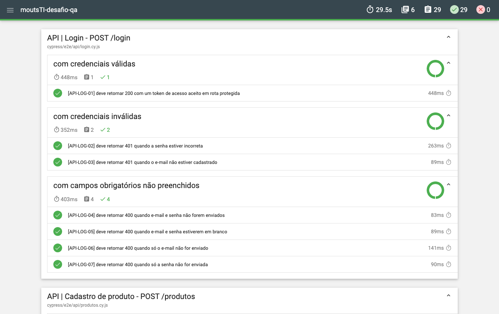

# Desafio Técnico Mouts TI - Senior QA Tester

[](https://github.com/michellemartinsavelar/moutsTI-desafio-qa/actions/workflows/testes.yml)

Oi! Eu sou a Michelle, e este repositório é a minha entrega para o desafio técnico da vaga de **Senior QA Tester** na **Mouts TI**.

É uma suíte de testes automatizados com **Cypress** e **JavaScript** para o [ServeRest](https://serverest.dev/), cobrindo o front-end ([front.serverest.dev](https://front.serverest.dev/)) e a API REST.

Este README traz o essencial. Quem quiser o detalhe de cada escolha encontra em [docs/decisoes.md](docs/decisoes.md), e os casos de teste estão descritos em [docs/plano-de-testes.md](docs/plano-de-testes.md).

## Sumário

- [Sobre o desafio](#sobre-o-desafio)
- [Cenários cobertos](#cenários-cobertos)
- [Como executar](#como-executar)
- [Estrutura do projeto](#estrutura-do-projeto)
- [Como os testes foram construídos](#como-os-testes-foram-construídos)
- [Massa de dados](#massa-de-dados)
- [CI/CD](#cicd)
- [Segurança](#segurança)
- [O que eu observei na aplicação](#o-que-eu-observei-na-aplicação)
- [O que deixei de fora e por quê](#o-que-deixei-de-fora-e-por-quê)
- [O que eu faria com mais tempo](#o-que-eu-faria-com-mais-tempo)

## Sobre o desafio

### O que foi pedido

- Automatizar **3 cenários E2E** no front-end: [front.serverest.dev](https://front.serverest.dev/)
- Automatizar **3 cenários de API** com base no Swagger: [serverest.dev](https://serverest.dev/)
- Cobrir cenários **positivos e negativos**
- Usar **Cypress** com **JavaScript** e hospedar o código em um repositório **público no GitHub**

### Onde encontrar cada critério de avaliação

| Critério                            | Onde eu tratei disso                                                                                         |
| ----------------------------------- | ------------------------------------------------------------------------------------------------------------ |
| Boas práticas e qualidade do código | [Como os testes foram construídos](#como-os-testes-foram-construídos) e [docs/decisoes.md](docs/decisoes.md) |
| Padrões de projeto                  | Page Object, Service Object, Factory e testes orientados a dados                                             |
| Assertivas claras e adequadas       | Status, mensagem, contrato, persistência e efeito colateral na API; tela e requisição interceptada no E2E    |
| Escrita e organização dos cenários  | `describe` / `context` / `it` padronizados, com ID por caso e um [plano de testes](docs/plano-de-testes.md)  |
| Uso de massa de dados               | [Massa de dados](#massa-de-dados): dados gerados, registro automático e limpeza ao final                     |
| CI/CD, segurança e documentação     | [CI/CD](#cicd), [Segurança](#segurança) e a pasta `docs/`                                                    |
| Qualidade e clareza dos commits     | Commits pequenos no padrão Conventional Commits, validados pelo commitlint                                   |

## Cenários cobertos

Escolhi **3 cenários de API** e **3 cenários E2E**: login, cadastro de usuário e cadastro de produto, nas duas camadas. No total são **29 casos de teste**, 7 positivos e 22 negativos. Cada caso tem um ID único, que aparece no título do teste e no relatório.

| Camada | Cenário             | Positivos | Negativos | IDs                         |
| ------ | ------------------- | --------- | --------- | --------------------------- |
| API    | Login               | 1         | 6         | `API-LOG-01` a `API-LOG-07` |
| API    | Cadastro de usuário | 1         | 5         | `API-USU-01` a `API-USU-06` |
| API    | Cadastro de produto | 1         | 6         | `API-PRO-01` a `API-PRO-07` |
| E2E    | Login               | 2         | 2         | `E2E-LOG-01` a `E2E-LOG-04` |
| E2E    | Cadastro de usuário | 1         | 1         | `E2E-USU-01` e `E2E-USU-02` |
| E2E    | Cadastro de produto | 1         | 2         | `E2E-PRO-01` a `E2E-PRO-03` |

Login e cadastro aparecem nas duas camadas de propósito, porque os riscos são diferentes. Na API eu testo a regra e o contrato, com mais negativos, por ser rápido. Na tela eu testo a integração: o formulário envia o dado certo, o erro aparece para o usuário e o redirecionamento acontece.

Todos os testes seguem a mesma estrutura. Eu gosto que o relatório possa ser lido como uma especificação:

```
API | Login - POST /login                         ← describe: funcionalidade e endpoint
  com credenciais inválidas                       ← context: condição de negócio
    ✓ [API-LOG-02] deve retornar 401 quando a senha estiver incorreta   ← it: ID e resultado esperado
```

<p align="center">
  
</p>

## Como executar

### Pré-requisitos

- Node.js **22.13 ou superior** (a versão que eu uso está no `.nvmrc`; com nvm, é só rodar `nvm use`)
- npm
- Git (no Windows, o [Git for Windows](https://gitforwindows.org/), que também roda os hooks do Husky)

O projeto funciona em **macOS, Linux e Windows**. Eu desenvolvi no macOS, e o pipeline roda lint e testes em Linux e em Windows. Um detalhe para quem usa Windows: o `nvm-windows` não lê o `.nvmrc`, então instale a versão com `nvm install 22` e `nvm use 22`, ou baixe o Node pelo [site oficial](https://nodejs.org/).

### Instalação

```bash
git clone https://github.com/michellemartinsavelar/moutsTI-desafio-qa.git
cd moutsTI-desafio-qa
npm ci
```

### Scripts

| Comando                | O que faz                                                |
| ---------------------- | -------------------------------------------------------- |
| `npm test`             | Executa todos os testes em modo headless                 |
| `npm run test:api`     | Executa apenas os testes de API                          |
| `npm run test:ui`      | Executa apenas os testes E2E                             |
| `npm run cy:open`      | Abre o Cypress no modo interativo                        |
| `npm run lint`         | Verifica o código com ESLint                             |
| `npm run format:check` | Verifica a formatação com Prettier                       |
| `npm run empacotar`    | Gera o `.zip` de entrega apenas com arquivos versionados |

Depois da execução, o relatório fica em `cypress/reports/index.html`.

### Ambientes

Por padrão, os testes apontam para o ServeRest público. Para rodar contra outro ambiente, basta trocar as URLs por variável de ambiente, sem mexer no código.

macOS e Linux:

```bash
BASE_URL=http://localhost:3000 API_URL=http://localhost:3001 npm test
```

Windows (PowerShell):

```powershell
$env:BASE_URL="http://localhost:3000"; $env:API_URL="http://localhost:3001"; npm test
```

Não é preciso configurar nenhuma credencial: cada teste cria os próprios usuários.

## Estrutura do projeto

```
cypress/
├── e2e/api e e2e/ui     # os testes: um arquivo por funcionalidade
├── fixtures/contratos   # JSON Schemas das respostas da API
├── tarefas/             # código que roda no Node: limpeza da massa e avisos
└── support/
    ├── comandos/        # pré-condições via API e acesso já autenticado
    ├── fabricas/        # geração de massa de dados
    ├── massa/           # registro do que os testes criam
    ├── paginas/         # page objects
    └── servicos/        # serviços da API
docs/                    # plano de testes e decisões técnicas
```

Pensei nessa estrutura para que incluir uma funcionalidade nova siga sempre o mesmo caminho: um serviço (API) ou uma página (UI), uma fábrica se houver massa nova, e o spec.

## Como os testes foram construídos

- **Page Object**: cada tela concentra seus seletores e ações. Deixei as **asserções nos specs**, porque prefiro que o teste mostre o que está sendo validado.
- **Service Object**: cada recurso da API tem um serviço com métodos de negócio (`cadastrar`, `listar`, `buscarPorId`). Uma classe base cuida da URL, do token e de não reprovar em 4xx, para o teste poder validar 400, 401 e 403.
- **Factory**: funções que geram dados válidos e aceitam sobrescritas, como `gerarUsuario({ email: emailExistente })`. Em um negativo, eu mudo só o campo que interessa.
- **Testes orientados a dados**: casos com a mesma estrutura ficam em uma tabela, e cada linha vira um teste com nome próprio no relatório.
- **Contrato**: valido as respostas de sucesso contra JSON Schemas com `additionalProperties: false`.

As três decisões que mais pesaram:

1. **Pré-condições pela API, tela só para o que o teste valida.** Fica mais rápido e mais estável. O login e o cadastro pela tela continuam cobertos nos seus próprios casos.
2. **Negativo não se prova só com status.** Nos casos de duplicidade e de falta de permissão, depois do erro eu consulto a API para confirmar que nada foi criado.
3. **Nenhuma espera fixa.** A sincronização é por asserção e por `cy.intercept`, e o lint proíbe `cy.wait(1000)`.

As demais estão em [docs/decisoes.md](docs/decisoes.md).

## Massa de dados

Foi o ponto em que eu mais investi, porque o ServeRest público é compartilhado e eu não queria depender dos dados dos outros nem deixar lixo para trás.

- **Dados gerados**: todo usuário e produto vem do Faker, com e-mail baseado em UUID e nome de produto com sufixo aleatório. Nenhum teste depende de outro.
- **Registro automático**: todo cadastro que devolve um `_id` é anotado no momento da resposta, antes de qualquer assertiva. Vale também para os negativos: se a aplicação criar algo que deveria recusar, o teste falha e o registro indevido é removido.
- **Limpeza ao final de cada teste**: uma tarefa no Node exclui o que foi anotado e trata cada exclusão separadamente. O que não puder ser removido vira aviso no terminal e no resumo do pipeline, sem reprovar o teste.

Dois tropeços que me ensinaram alguma coisa:

> **Massa que não era apagada.** O Cypress empacota o `support` e cada spec separadamente, então o módulo de massa era carregado mais de uma vez. O teste anotava em uma cópia e a limpeza olhava para outra, e um usuário ficou para trás no ambiente. Por isso hoje o registro fica em um único objeto no escopo global da página de teste.

> **Asserção que passava com valor errado.** Na listagem de produtos, eu comparava o texto da linha inteira. Com preço 1648, uma asserção procurando a quantidade 4 passava, porque o 4 está dentro do 1648. Agora confiro cada valor na sua coluna.

**Limite que eu conheço:** se o processo do Cypress for encerrado no meio de um teste, a limpeza daquele teste não roda.

## CI/CD

O workflow [`testes.yml`](.github/workflows/testes.yml) roda em todo push e pull request para a `main`, toda segunda-feira de manhã e também manualmente.

1. **Lint e formatação** primeiro, para falhar rápido.
2. **Testes de API e de UI** em paralelo, no Chrome, em **Linux** e em **Windows**.
3. **Relatório HTML** publicado como artefato, mesmo quando os testes falham.

No pipeline os testes têm até duas novas tentativas, porque o ambiente é público e pode oscilar. Para isso não esconder um teste instável, quem só passa depois de nova tentativa aparece no resumo do job. Na minha máquina não há nova tentativa.

## Segurança

- **Nenhuma credencial no repositório.** Cada teste cria e apaga os próprios usuários, com senha aleatória.
- **Pipeline com menor privilégio** (`contents: read`) e dependências sem vulnerabilidades conhecidas no `npm audit`, com o Dependabot acompanhando.
- **Configuração pública separada de segredo.** As URLs usam o `expose` do Cypress 16. Um segredo viria de variável de ambiente e, no pipeline, de GitHub Secrets.

## O que eu observei na aplicação

Testando, encontrei comportamentos do ServeRest que valem o registro:

- **Senha exposta:** `GET /usuarios` devolve a senha de todos os usuários em texto puro. Em uma aplicação real, eu reportaria como defeito crítico.
- **Tela de administrador aberta para usuário comum:** o front só verifica se existe um token, e não o perfil. Um usuário comum consegue abrir `/admin/cadastrarprodutos`. A API barra o cadastro com 403, então a proteção existe, mas só no back-end. O caso `E2E-PRO-03` documenta isso.
- **`DELETE` que responde 200 sem excluir nada**, com a mensagem "Nenhum registro excluído". Por isso a minha limpeza confere a mensagem, e não só o status.
- **"Bem Vindo" com dois espaços** antes do nome, na home administrativa.

## O que deixei de fora e por quê

- **Carrinho e lista de compras do cliente.** O desafio pedia três cenários por camada, e priorizei autenticação e autorização, que são a base de todo o resto.
- **Edição e exclusão pela tela.** Repetem o padrão de formulário que o cadastro já cobre.
- **Token expirado.** O token do ServeRest vale 10 minutos, e o teste precisaria esperar esse tempo.
- **Outros navegadores.** O pipeline roda só no Chrome.
- **Carga e acessibilidade.** São outros tipos de teste, com outras ferramentas, e não foram pedidos.

## O que eu faria com mais tempo

1. Um fluxo do cliente na loja: buscar um produto e adicioná-lo à lista de compras.
2. Rodar em mais de um navegador.
3. Levar para o pipeline o que hoje só roda na minha máquina: a validação das mensagens de commit e o `npm audit`.
